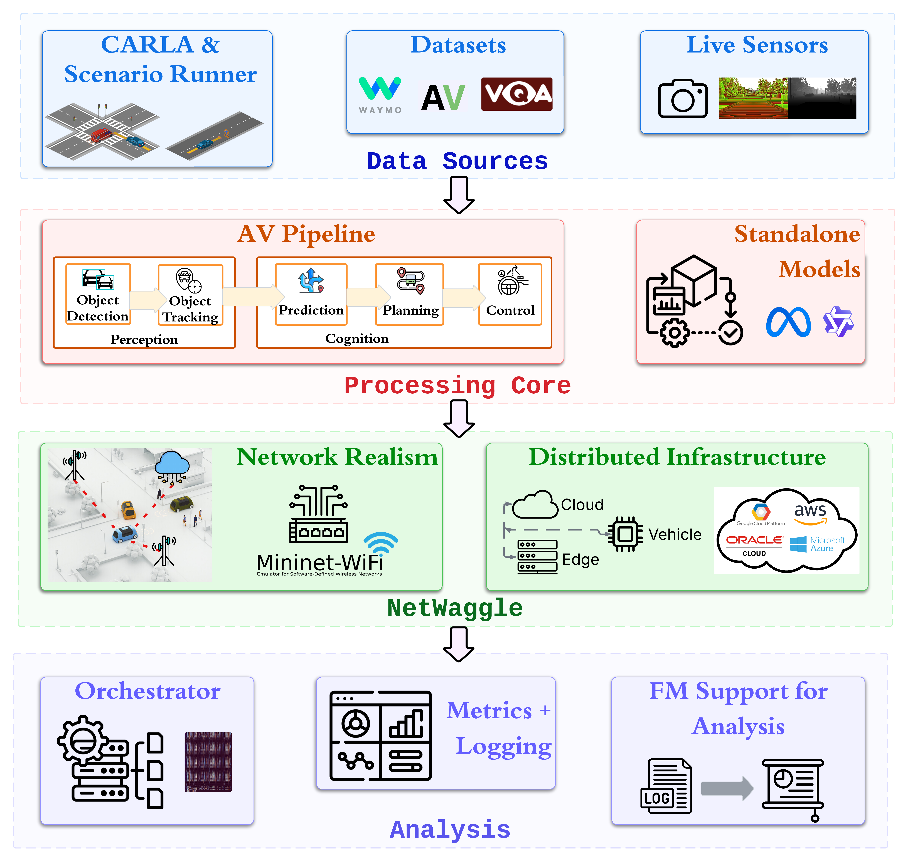

# CADET

**Cooperative Autonomy through Distributed Experimentation Toolkit**

CADET is a platform for measuring what a distributed deployment does to a
cooperative autonomy application. You describe an experiment in one YAML file -
an application pipeline, the device, edge and cloud nodes its stages are placed
on, and the emulated network links between them - and CADET runs it, places
every stage where the config says, shapes every link the way the config says,
and records model-level, system-level and task-level numbers for the run. Change
one line, run it again, and the difference belongs to the thing you changed.
CADET is application-agnostic: the framework owns configuration, sources, role
runtimes, transport, network emulation, metrics and orchestration, while
applications live under `examples/` and plug in through a registry. The
reference application is an autonomous-vehicle emergency-braking pipeline
derived from [ERDOS Pylot](https://github.com/erdos-project/pylot).

<p align="center">
  
</p>

CADET implements a modular four-layer architecture - **data source**,
**processing core**, **network emulation** and **analysis** - so a component can
be evaluated on its own or integrated for an end-to-end cooperative autonomy
experiment.

## Documentation

### **[nesl.github.io/cadet](https://nesl.github.io/cadet/)**

Tutorials, how-to guides, the full configuration reference, the API reference,
and a page per research question. Start with the
[quickstart](https://nesl.github.io/cadet/quickstart.html); the
[project page and demo videos](https://nesl.github.io/cadet-web) are separate.

## Install

CADET targets Python 3.8 through 3.13 and installs from a clone.

```bash
git clone https://github.com/nesl/cadet
cd cadet
python -m venv .venv && . .venv/bin/activate
pip install -U pip                 # 3.8 ships a pip that predates editable installs
pip install -e ".[examples]"
```

That is everything the quickstart below needs: **no simulator, no GPU, no
container and nothing downloaded.** `pip install -e .` on its own gives the
config and CLI layer, enough to `cadet validate` a config; `.[examples]` adds
the numpy, OpenCV and matplotlib the runnable examples encode frames and draw
plots with.

Configs that launch their own simulator want a docker client and the CARLA
client egg in the same process. The **`scripts/cadet`** wrapper is that
environment: it runs the same CLI inside the CADET image, so every subcommand
reaches it unchanged.

```bash
scripts/cadet run <config> --app-module <module>     # == cadet run <config> ...
```

[`requirements.txt`](requirements.txt) is a different thing again: the pinned
simulator and ML stack for the CARLA examples. The quickstart needs none of it.

## Quickstart

Three commands, from a fresh clone to a measured result on a page. Two sensors
stream frames to a gateway across an emulated access link, the gateway runs a
detector, and every frame is timed.

```bash
# 1. Check the config. Reports schema errors by name, and refuses any option
#    it cannot run rather than ignoring it.
cadet validate examples/distributed_sensing/quick.yaml --app-module examples.distributed_sensing.app

# 2. Run it. Finishes in a few seconds.
cadet run examples/distributed_sensing/quick.yaml --app-module examples.distributed_sensing.app

# 3. Read it: a local page, nothing fetched from the network.
cadet dashboard outputs/sensing_quick        # then open http://127.0.0.1:8787/
```

`--app-module` is not boilerplate. The framework never imports example code, so
an application under `examples/` has to be named; leaving it off is an error
that lists the registered modules and how to name one.

Results land in `outputs/{experiment}/{app}/{run_id}/`. `run_id` is derived from
the content of the resolved config, so the same config always maps to the same
directory and a sweep resumes by skipping the cells it already has. Every run
directory keeps the config it ran, so a result reads back without the sweep that
produced it.

## Examples by domain

| Domain | Example | The question it answers | Simulator |
|---|---|---|---|
| **Distributed sensing** | [`examples/distributed_sensing`](examples/distributed_sensing/README.md) | Many sensors fan in to a gateway over a contested access network. Does the detector belong on the sensors, on the gateway, or in the cloud? | No |
| **Dataset and VLM serving** | [`examples/dataset_vlm`](examples/dataset_vlm/README.md) | One vision-language model served over an evaluation dataset, with model-, system- and task-level numbers per run. What does the serving tier cost in accuracy and in latency? | No |
| **Multi-device placement** | [`examples/reference`](examples/reference/README.md) · [Tutorial 4](https://nesl.github.io/cadet/tutorials/04-multi-device.html) | The same pipeline with its stages placed across containers and across machines, over SSH. What does the move across a real host boundary add? | No |
| **AV emergency braking** | [`examples/braking`](examples/braking/flat/README.md) | Open-loop emergency braking split over device, edge and cloud. How late can perception be before the brake is late? | CARLA |
| **AV cooperative driving (V2V)** | [`examples/v2v`](examples/v2v/README.md) | Vehicle-to-vehicle cooperative braking: a follower braking on a leader's intent versus on its own perception, under DSRC and 5G link models. | CARLA |
| **AV infrastructure-assisted (V2I)** | [`examples/v2i`](examples/v2i/README.md) | A roadside unit fusing its own view with the vehicle's. What does infrastructure assistance buy, and at what latency? | CARLA |
| **AV component library** | [`examples/av_pipeline`](examples/av_pipeline/README.md) | The full perception → prediction → planning → control stack as plain Python, for the AV examples to draw on. | CARLA |

## How it works

A client runs the **source → process → transport → action → metrics** stages;
a server runs **transport → queue → model → reply**. Where consecutive stages
sit on different nodes, CADET inserts a boundary and realises it as a transport
link. Each link is emulated at a layer the config chooses with
`links[*].network.mode`:

- **`delay` - message-level.** An in-process delay line holds whole application
  messages, samples the configured distribution per message and reproduces it
  exactly; `loss` drops messages outright. Needs no privileges. Use it to state
  a latency distribution and have it honoured.
- **`netem` - packet-level, one host.** A `tc` qdisc on the sending node's
  interface, filtered to the link's peer and port, so other flows on that
  interface are untouched.
- **`netwaggle` - packet-level, emulated network.** A Mininet-WiFi topology with
  each node in its own namespace, a wired or wireless medium with a propagation
  model, and an unshaped bypass interface per host for framework plumbing.

The packet-level backends include the transport's own reaction to the link,
which is the point of them: on a 60 ms forward link, `delay` reports a median of
60.4 ms while `netem` and `netwaggle` report about 149 ms, falling to 110 ms
with `transport_tuning.tcp_nodelay: true`. Configured packet loss shows up as
retransmission latency rather than as unanswered messages. Every run writes a
`link_report.json` with the configured parameters beside the measured ones.

## Configuration

Experiments are declarative YAML validated against a typed schema, and short
configs share a base with `extends:`. `--set key=value` overrides any field by
its dotted path and is reflected in the run hash. The
[configuration reference](https://nesl.github.io/cadet/config-reference.html)
documents every section and option; `cadet/config/implemented.py` is the
authority on what each one does and the run that verified it.

When a command cannot do what it was asked, it says what to do instead. A config
naming an option CADET will not run is refused by name at `cadet validate`. A
node placed in a container on a machine without that image is refused with the
`docker build` command that makes one. A node asking for a GPU the machine does
not have is refused with the node's name and the range the machine reports.

## Citation

```bibtex
@inproceedings{sharma2026cadet,
  title     = {{CADET}: A Modular Platform for Evaluating Distributed
               Cooperative Autonomy in Connected Autonomous Vehicles},
  author    = {Sharma, Pragya and Wang, Brian and Srivastava, Mani},
  booktitle = {2026 IEEE International Conference on Robotics and Automation (ICRA)},
  year      = {2026},
  publisher = {IEEE},
  doi       = {10.1109/ICRA57385.2026.11696961},
}
```

The paper is on [arXiv](https://arxiv.org/abs/2606.04072). See
[Citing CADET](https://nesl.github.io/cadet/community/citing.html) for the
related publications and the acknowledgements.

## License

Apache License 2.0 - see [`LICENSE`](LICENSE) and [`NOTICE`](NOTICE). The code
under `cadet/` and `examples/av_pipeline/` is derived and modified from ERDOS
Pylot (Apache-2.0).
