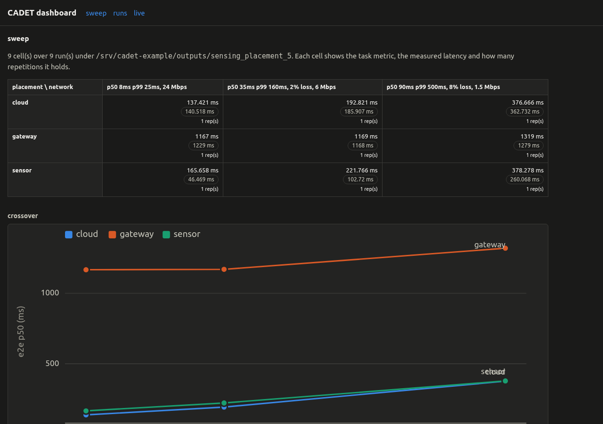
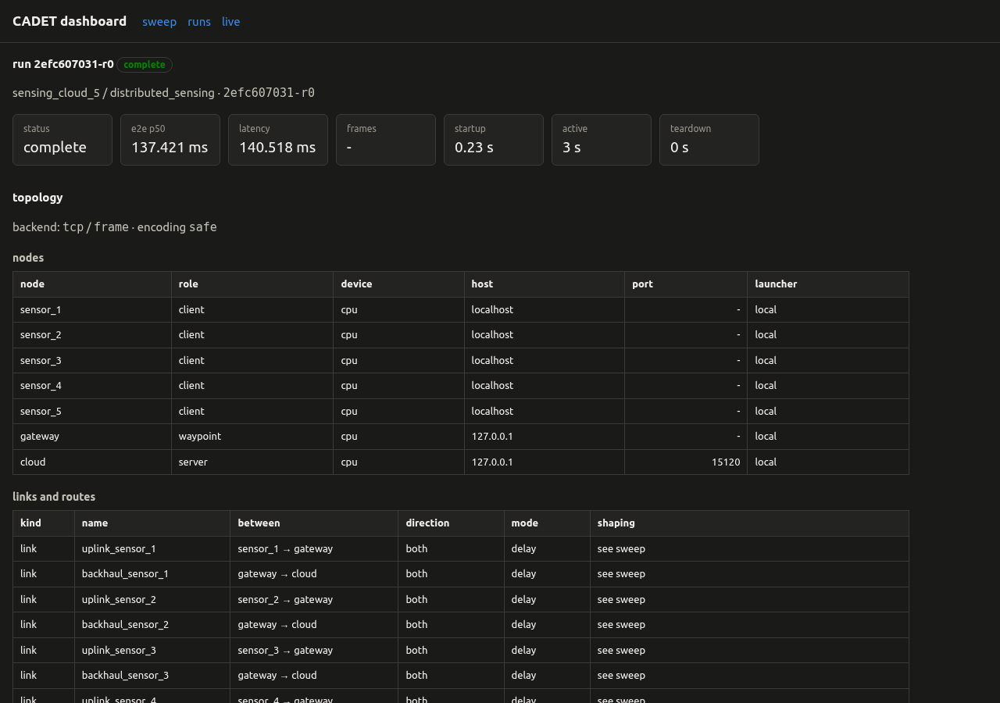

Distributed Sensing
===================

N sensor nodes stream frames over a contested access network into one gateway;
the detector runs on each sensor, on the gateway, or in the cloud. The example
measures what that placement choice costs in latency, age of information, and
bytes on the access link.

What it measures
----------------

Four quantities per run:

- **End-to-end latency** — from a frame's capture on a sensor to the detection
  result arriving back at it
- **Age of information** — from a frame's capture to its arrival at the node
  that processes it
- **Detection rate** — fraction of frames whose result carried at least one box
- **Bytes per link** — payload each sensor put on its uplink; the placement
  decides whether that payload is boxes or an encoded frame

The fan-in is what the comparison turns on. Every sensor is its own process
with its own connection, and the processing node holds one detector behind one
queue, so N sensors share one compute budget while each sensor has its own.

Quick run
---------

Two synthetic sensors, one gateway, no CARLA, no download::

    cadet run examples/distributed_sensing/quick.yaml --app-module examples.distributed_sensing.app

Result : 40 of 40 frames answered, median
end-to-end latency 88.9 ms, median age of information 42.2 ms, 2.4 s of worker
time.

The full matrix
---------------

The configs split across two dimensions the sweep machinery cannot handle as a
single axis: sensor count changes the node and link lists together (not a
dotted-path axis), and placement changes the topology (the cloud placement adds
a waypoint node). Each combination is its own file.

.. list-table::
   :header-rows: 1
   :widths: 25 20 15 20 20

   * - Config
     - Topology
     - Sensors
     - Sweeps
     - Backend
   * - ``quick.yaml``
     - sensors → gateway
     - 2
     - none
     - delay
   * - ``edge_2/5/10.yaml``
     - sensors → gateway
     - 2, 5, 10
     - placement × access quality (3)
     - delay
   * - ``cloud_2/5/10.yaml``
     - sensors → gateway → cloud
     - 2, 5, 10
     - access quality (3)
     - delay
   * - ``netem_5.yaml``
     - sensors → gateway
     - 5
     - placement × access quality (3)
     - netem (packet-level)
   * - ``queue_5.yaml``
     - sensors → gateway
     - 5
     - placement × access quality (3)
     - delay, freshness policy on
   * - ``replay.yaml``
     - as ``edge_5.yaml``
     - 5
     - as ``edge_5.yaml``
     - delay
   * - ``wifi_5.yaml``
     - Wi-Fi cell → gateway
     - 5
     - none
     - netwaggle, one Wi-Fi cell
   * - ``emulated_5.yaml``
     - sensors → gateway
     - 5
     - access quality (3)
     - netwaggle wired (emulation container)

``netem_5.yaml`` uses the same topology and swept axes as ``edge_5.yaml`` but
shapes at the packet level (netem) rather than the message level. Comparing the
two shows what TCP retransmit costs at each condition. ``queue_5.yaml`` adds a
freshness policy on the gateway's inbound queue; comparing it cell-by-cell with
``edge_5.yaml`` isolates the effect of letting stale frames queue.

The edge configs below show the full topology and sweep definition:

.. literalinclude:: ../../../examples/distributed_sensing/edge_5.yaml
   :language: yaml
   :caption: Five-sensor edge sweep — ``examples/distributed_sensing/edge_5.yaml``

One-command placement sweep
~~~~~~~~~~~~~~~~~~~~~~~~~~~

``placement_sweep.py`` runs the full three-placement comparison in one command::

    python examples/distributed_sensing/placement_sweep.py --sensors 5

That shells out to ``cadet sweep`` for the edge and cloud configs, reduces
every run to one row in ``outputs/sensing_placement_5/summary.csv``, prints the
table, and writes the crossover plot to
``outputs/sensing_placement_5/crossover.png``. Takes about 75 s for five sensors.

While it is running, open the dashboard in another terminal::

    cadet dashboard outputs/sensing_placement_5

The dashboard's live view refreshes the sweep matrix as runs complete. After
the sweep finishes, the same command shows the full matrix and crossover plot.

Manual sweep
~~~~~~~~~~~~

To drive the two sweeps separately::

    cadet sweep examples/distributed_sensing/edge_5.yaml  --app-module examples.distributed_sensing.app
    cadet sweep examples/distributed_sensing/cloud_5.yaml --app-module examples.distributed_sensing.app
    python examples/distributed_sensing/summarise.py --write outputs/sensing_edge_5/distributed_sensing/*-r0
    cadet dashboard outputs/sensing_edge_5

``summarise.py --write`` writes ``sensing_summary.json`` into each run directory;
the dashboard reads every ``*_summary.json`` under the tree and takes the first
numeric field (``e2e_p50_ms``) as the headline metric.

   Dashboard sweep view from ``python examples/distributed_sensing/placement_sweep.py --sensors
   5``: placement × access-quality matrix (9 cells, 2 reps each) and crossover
   plot. Cloud and sensor placements stay well below the gateway, which saturates
   at five sensors and holds its latency nearly flat as access quality degrades.

   Per-run view for the cloud placement: node table (gateway as waypoint, cloud
   as server), per-sensor uplink and backhaul link table, and per-stage latency.
   The waypoint role is what distinguishes the cloud topology from the edge one
   in the dashboard.

Results
-------

Measured on a single host with the ``delay`` backend, 5 sensors, 20 generated
frames per sensor at 10 fps. Latencies
are the median over answered frames of all five sensors.

**Placement × access quality, 5 sensors:**

.. list-table::
   :header-rows: 1
   :widths: 15 16 16 16 16 16 15 10

   * - Placement
     - e2e p50, good
     - e2e, contested
     - e2e, severe
     - AoI p50, good
     - AoI, contested
     - AoI, severe
     - Uplink
   * - sensor
     - 138.0 ms
     - 202.3 ms
     - 415.5 ms
     - 128.9 ms
     - 158.7 ms
     - 234.6 ms
     - 16.3 KB
   * - gateway
     - 1097.8 ms
     - 1126.3 ms
     - 1217.8 ms
     - 1043.6 ms
     - 1012.6 ms
     - 1030.8 ms
     - 52.0 KB
   * - cloud
     - 96.5 ms
     - 164.7 ms
     - 325.6 ms
     - 41.8 ms
     - 72.8 ms
     - 132.7 ms
     - 52.0 KB

The gateway placement is over capacity: five sensors at 10 fps offer 50 frames
per second; one gateway detector at 40 ms per frame serves 25 (both numbers from
``_base.yaml``). The cloud detector at 12 ms per frame serves 83 and stays ahead
of the offered load.

**Placement × sensor count, good access quality:**

.. list-table::
   :header-rows: 1
   :widths: 25 25 25 25

   * - Sensors
     - sensor
     - gateway
     - cloud
   * - 2
     - 140.7 ms
     - 69.0 ms
     - 89.5 ms
   * - 5
     - 138.0 ms
     - 1097.8 ms
     - 96.5 ms
   * - 10
     - 138.2 ms
     - 2688.3 ms
     - 377.5 ms

The sensor placement is flat across all three counts: each sensor runs its own
detector and its own source loop, so adding sensors adds independent workers
rather than queue depth. At two sensors the gateway wins because detector cost
dominates and the gateway's is lower; by five sensors the gateway has saturated.

The replay config (20 cached COCO images per sensor) sharpens the bytes
comparison: sensor placement put 14.9 KB on the five uplinks, gateway placement
put 6752 KB — a factor of 453 — and gateway median end-to-end latency at good
access quality was 1301.2 ms vs the sensor run's 138.5 ms.

Network model
-------------

Three access quality tiers:

.. list-table::
   :header-rows: 1
   :widths: 18 15 15 12 20

   * - Quality
     - ``p50_ms``
     - ``p99_ms``
     - ``loss``
     - ``bandwidth_mbps``
   * - good
     - 8
     - 25
     - 0
     - 24
   * - contested
     - 35
     - 160
     - 0.02
     - 6
   * - severe
     - 90
     - 500
     - 0.08
     - 1.5

Cloud configs add a fixed backhaul at ``p50_ms: 25``, ``p99_ms: 90``,
``loss: 0.005``, ``bandwidth_mbps: 50``, and sweep the access quality, so a
cloud run and an edge run at the same quality differ in path and not in the
swept axis.

Detector cost is a config input (``app.params.detect_ms`` in ``_base.yaml``):
120 ms per frame on the sensor, 40 ms on the gateway, 12 ms in the cloud. The
shipped configs use ``detector: stub``, which pays that cost and returns a box
count derived from the frame's bytes; set ``detector: yolo`` to resolve a real
model through the model registry instead.

Metrics and output files
------------------------

Each run writes to ``outputs/<experiment>/distributed_sensing/<run_id>/``:

- ``sensor_<id>_events.csv`` — one per sensor; columns: ``capture_time``,
  ``send_time``, ``bytes_sent``, ``sensor_detect_ms``, ``remote_detect_ms``,
  ``detections``, ``aoi_ms``, ``reply_time``, ``e2e_latency_ms``,
  ``round_trip_ms``
- ``arrivals_<config_hash>.csv`` — one per run; columns: ``arrival_time``,
  ``aoi_ms``, ``bytes_in``, ``detections``, ``detect_ms``, ``detected_here``
- ``link_report_<node>.json`` — written by the framework; configured link
  parameters beside per-message latencies

Age of information needs no new collector. The sensor stamps its capture time
into the payload; the processing node stamps arrival; the difference is written
to ``arrivals_<config_hash>.csv`` and returned to the sensor. This holds because
every role in one run shares the host clock. For runs spread across hosts, add
``metrics.collectors: [clock_offset]`` to correct the timestamps.

``examples/distributed_sensing/placement_sweep.py`` writes ``sensing_summary.json`` into each
run directory automatically. The dashboard reads every ``*_summary.json``
under the runs directory and takes the first numeric field (``e2e_p50_ms``)
as the headline metric.

To reduce runs from a manual sweep::

    python examples/distributed_sensing/summarise.py --write outputs/sensing_edge_5/distributed_sensing/*-r0
    cadet dashboard outputs/sensing_edge_5

Stop the dashboard with ``Ctrl-C``.

Two-machine run
---------------

``examples/distributed_sensing/two_host.yaml`` runs the same example across two machines:
sensors stay on the local host (as processes), the gateway runs in a container
on a second machine via the ``ssh_docker`` launcher. The three values that name
the second machine are passed on the command line so the config itself stays
environment-agnostic::

    cadet run examples/distributed_sensing/two_host.yaml --app-module examples.distributed_sensing.app \
      --set nodes.2.host=<address> \
      --set nodes.2.user=<account> \
      --set nodes.2.ssh_identity=/path/to/private/key

Run from a host account, not from ``scripts/cadet``: the orchestrator
authenticates as the invoking account using that account's own SSH key, and a
key does not belong inside a container image.

The second machine needs: a docker daemon its account can use, the ``cadet:dev``
image, and the orchestrator's public key in that account's ``authorized_keys``.
No repository checkout and no CADET install are required on the second machine.

``two_host.yaml`` enables all five device collectors plus
``clock_offset``::

    metrics:
      collectors: [cpu, gpu, energy, bandwidth, clock_offset]

The ``clock_offset`` collector records the difference between the two hosts'
clocks rather than correcting it, so a cross-machine interval can be read with
that uncertainty carried.

Dataset for replay
~~~~~~~~~~~~~~~~~~

``examples/distributed_sensing/fetch_frames.py`` downloads 20 COCO val2017 images into
``datasets/distributed_sensing/coco-val2017`` (excluded from git). The fetcher reads the
archive in stream order and stops after enough images, so 20 images cost
3.5 MB of the 778 MB archive::

    python examples/distributed_sensing/fetch_frames.py --limit 20
    cadet sweep examples/distributed_sensing/replay.yaml --app-module examples.distributed_sensing.app

What each config needs
----------------------

- ``wifi_5.yaml`` needs the emulation container with the wireless stack:
  ``mac80211_hwsim`` loads into the host kernel (a global change on a shared
  machine). The topology is generated and validated correctly, but the wireless
  backend is topology-verified and not run; see the README.
- ``emulated_5.yaml`` needs the emulation container too, but only for
  openvswitch and sch_netem (no wireless stack change). Run with
  ``cadet emulate``; a plain ``cadet run`` applies no shaping.
- Composed routes do not model shared backhaul contention. ``realise: compose``
  gives one end-to-end connection per sensor whose hops' delays add; the N paths
  in a cloud config do not contend for one backhaul queue.

Features used
-------------

All features used by the single-host configs are marked Supported in
``cadet/config/implemented.py``:

- ``source.kind: synthetic`` and ``replay``
- ``nodes.launcher: local``
- ``links.network.mode: delay`` (sweeping configs); ``netem`` (``netem_5.yaml``)
- ``netwaggle`` with ``medium: wifi`` (``wifi_5.yaml``); wired medium
  (``emulated_5.yaml``, requires emulation container)
- ``routes.realise: compose`` (cloud configs)
- ``transport.protocol: tcp``, ``transport.mode: frame``

``two_host.yaml`` additionally uses ``launcher: ssh_docker`` for a real
second machine.

See also
--------

- :doc:`../research-goals/distributed-sensing` — the research question and how
  to extend the example
- :doc:`../tutorials/06-write-an-app` — writing an app plugin
- :doc:`../explanation/netwaggle-layer` — network backend reference
- :doc:`../howto/link-distributions` — loss and delay parameters
