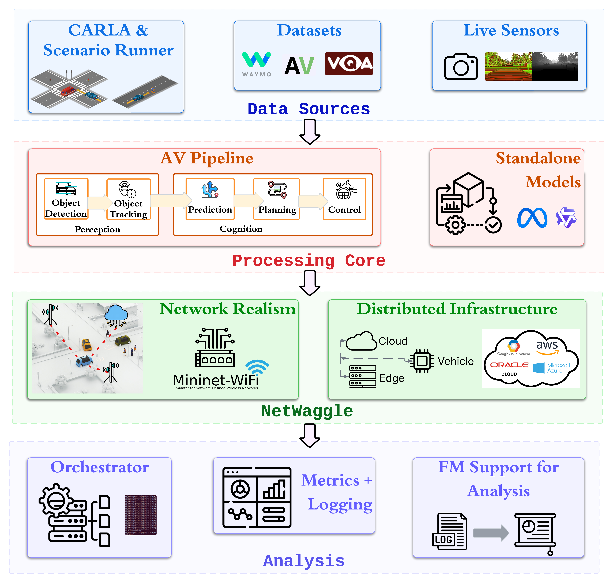
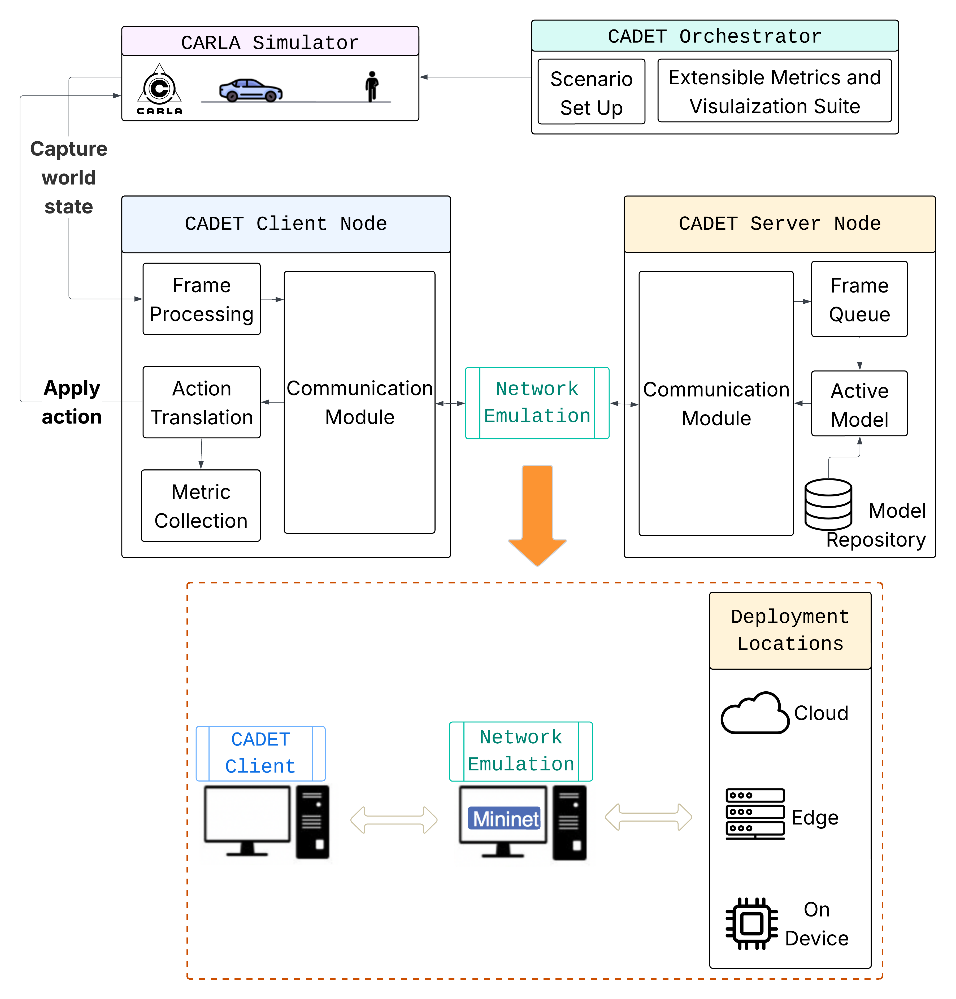

Architecture
============

CADET structures a cooperative-AV experiment as four layers, each with a single
responsibility. The diagram below shows how data flows through them.

   (a) CADET implements a modular four-layer architecture allowing components
   to be evaluated in isolation or integrated for end-to-end cooperative
   autonomy experiments. (Figure from the CADET paper.)

   (b) NetWaggle enables distributed inference under device heterogeneity
   and realistic network dynamics. It adopts a client–server design and
   mimics real-world network profiles. (Figure from the CADET paper.)

See :doc:`../explanation/network-backends` for the three network backends and
:doc:`../explanation/reproducibility` for run IDs and sweeps.

----

Data Source layer
-----------------

The source layer provides frames to the client process. Swapping a source
does not change the rest of the experiment: the client sees the same
``(frame_id, image_bytes)`` stream regardless of where frames come from.

**CARLA** (``source.kind: carla``)
    Connects to a running CARLA 0.9.10 simulator. The CARLA world runs in
    fixed-timestep mode (a simulator setting); ScenarioRunner's
    ``ScenarioManager`` drives ``world.tick()`` internally. CADET's client
    attaches passively via camera callback — it never calls ``world.tick()``
    itself, so CADET's own control loop is asynchronous: the server-side
    processing and client camera loop run concurrently without a blocking tick
    call.

    CADET does not spawn CARLA; the simulator must be running before the
    experiment starts (see :doc:`../quickstart` for the compose setup).
    ScenarioRunner runs as a *sim hook*: the orchestrator launches it as a
    subprocess before the client connects, and ScenarioRunner spawns the ego
    vehicle so the client can attach. CARLA is ``carlasim/carla:0.9.10``; the
    Python client is the PythonAPI egg, not the PyPI wheel. A preflight check
    verifies connectivity before the run starts.

**Replay** (``source.kind: replay``)
    Reads a directory of images (sorted lexicographically) or a video file at the
    configured FPS. The same directory always produces the same frame sequence.
    No external process required.

**Synthetic** (``source.kind: synthetic``)
    Generates solid-colour frames of a fixed size in memory. No files, no
    simulator, no GPU required. Used by the framework's test suite and for
    benchmarking the transport and network stack in isolation.

**Live** (``source.kind: live``)
    The replay source with a capture reader instead of a directory: an OpenCV
    capture opened on an integer ``device`` index or on a stream ``url``
    (exactly one of the two). ``fps`` caps the pull rate, ``0`` taking frames as
    fast as the stream delivers them, and ``limit`` is what ends the run. Run
    against an HTTP stream; the device form is not verified on a camera.

----

Processing Core layer
---------------------

The processing core hosts the perception pipeline and the model registry.

**AV pipeline**
    Nine stage implementations in ``cadet/pipeline/stages/``, each named by
    ``impl`` in a ``pipeline`` block and each placed on a node: braking is
    ``camera``, ``yolo``, ``roi_consecutive`` and ``brake_controller``, with
    V2V and V2I adding their own gates. A change of node is a boundary the
    runtime realises as a transport link, so the same config runs with the
    stages together or apart. The detection, tracking and prediction component
    library they draw on is ``examples/av_pipeline/pipeline/``, ported from
    Pylot (Apache-2.0; see ``NOTICE``).

**Model registry**
    A logical model name (e.g. ``"pedestrian_v2"``) maps to per-device artifact
    paths in ``models.registry``. At run time the orchestrator picks the artifact
    for the server node's ``device`` type (``gpu``, ``edge``, ``hailo``, ...),
    so the same config runs on different hardware without edits.

    ``models.warmup: true`` (the default) runs one inference before the
    experiment starts. This avoids the cost of loading weights onto the GPU,
    model fusing, and cuDNN kernel setup on the first real frame.

----

NetWaggle layer
---------------

CADET separates two kinds of connections:

**Channels**: direct data paths with no emulation.
    A channel connects two nodes over a plain TCP socket.  No qdisc is installed,
    no delay is added. Use a channel when the two nodes share a host or when you
    want to study model latency in isolation from network effects.

**Links**: emulated-network paths.
    A link has an associated ``NetworkModel`` (``network.mode``, distribution,
    loss, bandwidth). The orchestrator wires the appropriate backend at startup
    and tears it down on exit, even after a crash, so a failed run never leaves
    traffic shaped.

Three backends are available; see :doc:`../explanation/network-backends` for a
full comparison including why their latency numbers differ.

----

Analysis layer
--------------

**Orchestrator**
    The orchestrator turns a config into running processes and back again. Its
    startup order is fixed: cleanup → preflight → netem install → servers → sim hooks →
    clients/load → wait → teardown. A run is skipped on resume only when its
    ``run.json`` has ``"status": "complete"``; a failed run is retried.
    See :ref:`orch-lifecycle` below for the detailed sequence.

**Metrics**
    Two recorders run every experiment: the frame-level latency log
    (``{run_id}_latency_location_log.csv``) and the link report
    (``link_report.json``). An optional ``queue`` collector can be added with
    ``metrics.collectors: [queue]``. See :doc:`../reference/metrics` for field
    definitions.

**Config and sweeps**
    One YAML config drives everything. ``extends:`` composes configs from a base.
    ``sweep.axes`` defines a Cartesian product of parameter values; the orchestrator
    runs each cell and skips completed ones on resume. See
    :doc:`../explanation/reproducibility` for how run IDs are derived.

**FM interface**
    ``cadet summarize`` and ``cadet ask`` reduce a run directory or a sweep to a
    record and put it to an OpenAI-compatible chat-completions endpoint named in
    the ``analysis`` section. The key is read from the environment variable the
    config names.

----

.. _orch-lifecycle:

Orchestrator lifecycle
----------------------

The orchestrator starts all processes in a fixed order and tears them down in
reverse:

1. **Cleanup**: kill any CADET orphan processes from a previous run and free
   their ports. Scoped to processes CADET owns (by pid file or cmdline match)
   and containers prefixed ``cadet-``.
2. **Preflight**: check model artifact paths, port availability, and (if links
   are configured) emit a throughput warning if offered frame rate exceeds link
   capacity.
3. **Netem install**: apply ``tc`` qdiscs for any ``netem`` links.
4. **Servers**: start server nodes; wait until each logs
   ``"Waiting for connection"`` before proceeding (timeout: 60 s per server).
5. **Sim hooks**: start the simulator hook (ScenarioRunner for CARLA
   experiments); wait for its readiness marker.
6. **Clients / load workers**: start client and load nodes.
7. **Wait for workers**: block until ``end_on`` fires or a time limit is hit.
8. **Teardown** — stop processes in reverse startup order; remove netem qdiscs;
   clear state store.

A run ends with one of these reasons (recorded in ``run.json``):

.. list-table::
   :header-rows: 1
   :widths: 30 70

   * - ``reason``
     - When it fires
   * - ``"workers exited"``
     - All client/load workers exited cleanly.
   * - ``"active time limit"``
     - ``experiment.max_active_s`` was reached during the worker phase.
   * - ``"startup time limit"``
     - ``experiment.max_startup_s`` was reached before workers started.
   * - ``"node exited unexpectedly"``
     - A guard process (server or sim hook) exited with a non-zero code.
   * - ``"sim hook exited"``
     - A sim hook exited cleanly when ``end_on`` is ``sim_hook_exit`` or
       ``first``.
   * - ``"interrupted"``
     - The orchestrator received SIGTERM or SIGHUP.

**``end_on`` values:**

- ``client_report`` (default): wait for all client workers to finish.
- ``sim_hook_exit``: end when the sim hook exits cleanly; apply
  ``experiment.end_grace_s`` (default 5 s) before stopping clients.
- ``first``: end when either clients or the sim hook finishes first.

**Time limits:**

- ``experiment.max_startup_s``: bounds the cleanup + preflight + shaping +
  readiness phases. Defaults to the sum of all readiness timeouts, or 120 s.
- ``experiment.max_active_s``: bounds the worker phase. Defaults to
  ``source.scenario.timeout_s + 60`` if set, otherwise 600 s.

**``cadet down``** kills all CADET-owned processes, containers (``cadet-*``),
and emulation namespaces recorded in the state store, then clears it.

----

Feature status
--------------

``cadet validate`` names any option a config asks for that CADET will not run,
and refuses the run. What it accepts:

.. list-table::
   :header-rows: 1
   :widths: 40 20 40

   * - Feature
     - Status
     - Notes
   * - ``source.kind: live``
     - **Supported**
     - Capture on a device index or a stream URL; run against a stream, not on a camera
   * - ``nodes.launcher: docker``
     - **Supported**
     - Per-node container on a per-run network; lifecycle matrix passed
   * - ``nodes.launcher: ssh_docker``
     - **Supported**
     - A role in a container on a second machine; four lifecycle cases passed
   * - ``nodes.launcher: ssh_venv``
     - **Supported**
     - A role as a process in a virtual environment on a second machine, for a
       device that cannot hold a container image
   * - ``transport.protocol: websocket``
     - **Supported**
     - RFC 6455 binary frames after one HTTP upgrade; run end to end over it
   * - ``transport.mode: stream``
     - **Supported**
     - No length prefix; each record's extent read from the record itself
   * - ``metrics.collectors: gpu/cpu/bandwidth/energy/clock_offset``
     - **Supported**
     - Each runs on the node it measures and writes a per-node CSV
   * - ``routes.realise: compose``
     - **Supported**
     - Hops' delays compose into one model; measured on ``delay`` and ``netem``

This table is maintained by hand and has drifted before. The authority is
``cadet/config/implemented.py``, which carries each option's tier **and the run
that verified it**; ``cadet validate`` reads that module, not this page.
