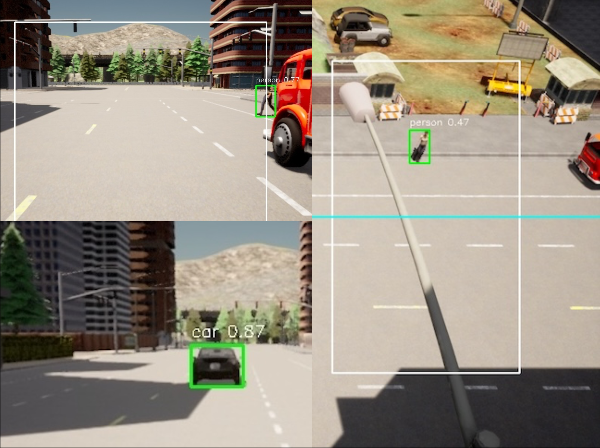

Data Source Layer
=================

The data source layer provides frames to the client process. Swapping a
source does not change any other part of the experiment: the client sees
the same ``(frame_id, image_bytes)`` stream regardless of where frames
come from.

Implemented sources
-------------------

**CARLA** (``source.kind: carla``)
    Connects to a running CARLA 0.9.10 simulator. CADET does not spawn
    CARLA; the simulator must be running before the experiment starts (see
    :doc:`../getting-started/installation` for the compose setup).

    In sync mode, ScenarioRunner's ``ScenarioManager`` calls
    ``world.tick()`` internally. CADET's client attaches passively: it
    connects to the ego vehicle that ScenarioRunner has already spawned,
    mounts a camera, and receives frames via a callback queue. The client
    never calls ``world.tick()``.

**Replay** (``source.kind: replay``)
    Reads a directory of images (sorted lexicographically) or a video file
    at the configured FPS. Deterministic and reproducible. No external
    processes required.

**Synthetic** (``source.kind: synthetic``)
    Generates solid-colour frames of a fixed size in memory. Zero
    dependencies: no files, no simulator, no GPU. Used by the test suite
    and for benchmarking the transport stack in isolation.

**Live** (``source.kind: live``)
    The replay source pointed at something arriving in real time: an OpenCV
    capture on an integer ``device`` index or on a stream ``url``, exactly one
    of the two. Everything above the reader - the pacing, the frame counting,
    the stop condition - is replay's, so a live config is a replay config with
    a different target. ``fps: 0`` (the default) lets the stream set the rate;
    ``limit`` caps the frames emitted and is what makes the run finish, since
    an empty read from a stream means "nothing yet" rather than "finished".
    Verified against an HTTP stream; the device form has not been run against
    a camera.

CARLA simulation captures
-------------------------

   Example CADET simulation captures: (a) (bottom-left) V2V scenario showing a
   platooning leader–follower interaction; (b) (top-left) ego vehicle camera view.
   (right) infrastructure camera view illustrating V2I perception.
   (Figure from the CADET paper.)

Swapping sources
----------------

Change only the ``source`` block to switch between sources. The rest of
the config (nodes, links, app, metrics) stays the same. This lets you
validate a pipeline with a synthetic source before connecting to a CARLA
server.
