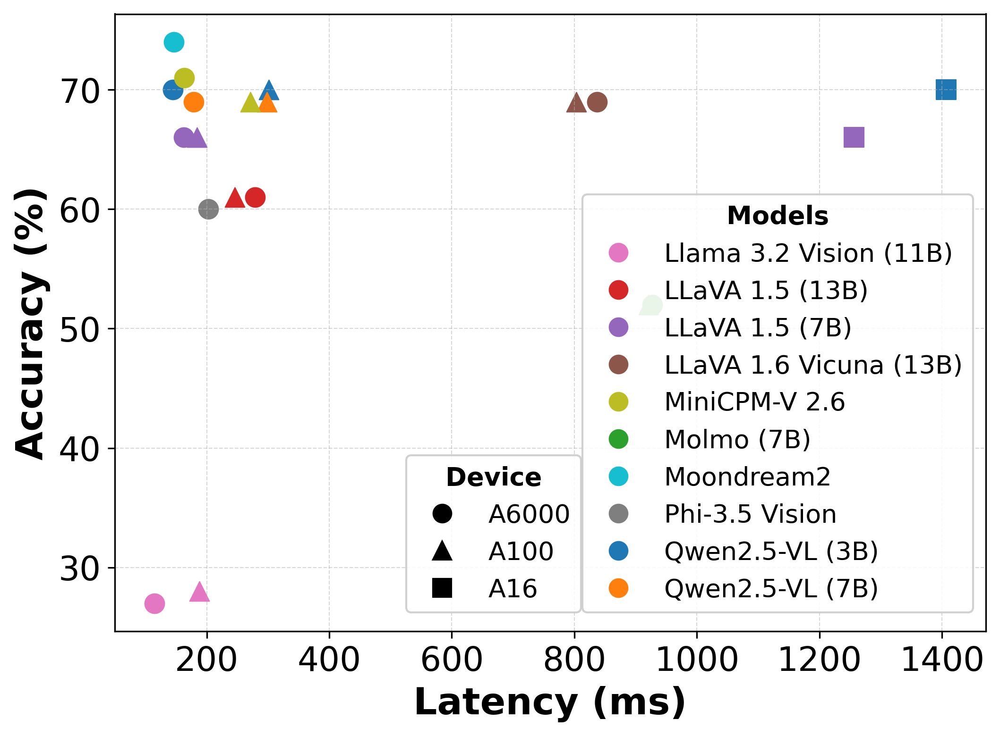

Dataset Mode
============

CADET's *dataset mode* runs the processing pipeline over pre-recorded frames
rather than a live CARLA simulation. Two source kinds support it:

``source.kind: replay``
    Reads a directory of images (sorted lexicographically) or a video file
    at the configured FPS. Frames are deterministic and reproducible.
    Implemented in :mod:`cadet.sources.replay`.

``source.kind: synthetic``
    Generates solid-colour frames in memory at a fixed size. No files or
    simulator required. Used by the test suite and for transport benchmarks.

Both sources feed the same server-side processing chain as a live CARLA run.
Swapping ``source.kind`` in the config is enough to switch between live
simulation and replay; nodes, links, app, and metrics config stay unchanged.

Reading a run back with a model
--------------------------------

The paper evaluates ten VLMs for cooperative autonomy tasks, showing
accuracy-latency profiles that vary with model size and GPU class.

``cadet summarize`` and ``cadet ask`` put a run's own record to a model rather
than its frames: they reduce a run directory or a sweep to its configs, run
records, metrics summaries and link reports, and send that to the endpoint named
in the ``analysis`` section. See :doc:`analysis-layer`.

   Accuracy–latency tradeoffs for different VLMs across heterogeneous
   deployment platforms. (Figure from the CADET paper.)

See also
--------

- :doc:`../examples/dataset-vlm` — configs, commands, and output for the
  placement sweep
- :doc:`../tutorials/05-sweeps` — running and resuming sweeps
