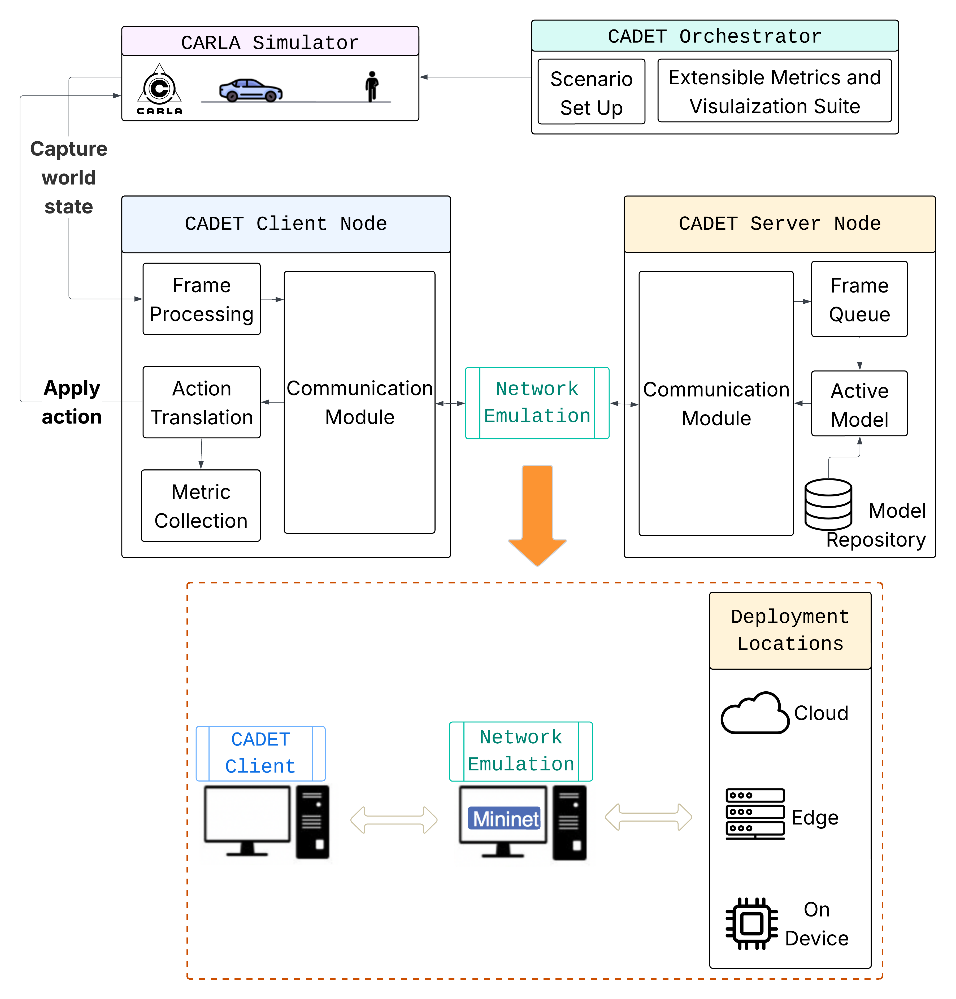

NetWaggle Layer
===============

The NetWaggle layer injects latency, jitter, loss, and topology between
nodes. It is optional: a config with no ``links`` block runs without any
network emulation.

Channels vs links
-----------------

CADET separates two kinds of connections:

**Channels** are direct data paths with no emulation. A channel connects
two nodes over a plain TCP socket with no qdisc installed and no delay
added. The netem backend excludes channel traffic from its filter rules,
so channels sharing an interface with a shaped link are never accidentally
delayed.

**Links** are emulated-network paths. Every link has a ``NetworkModel``
block (``network.mode``, distribution, loss, bandwidth). The orchestrator
installs the backend at startup and removes it on teardown, even after a
crash.

The rule is structural: channels cannot have a ``network`` block, and
links cannot be promoted to channels after the fact.

Three backends
--------------

.. list-table::
   :header-rows: 1
   :widths: 14 18 18 20 30

   * - Mode
     - Granularity
     - Where it runs
     - Delay semantics
     - Use when
   * - ``delay``
     - Message-level
     - In-process (transport)
     - Sampled per application message; distribution honoured per message
     - You want a specified latency distribution without TCP interaction
   * - ``netem``
     - Packet-level
     - ``tc`` qdisc in the node container
     - Applied per packet; TCP reacts (Nagle, retransmit, CWND)
     - You want to see how a real protocol stack behaves on a degraded path
   * - ``netwaggle``
     - Packet-level
     - Mininet-WiFi in a privileged container
     - Same as netem, plus propagation model for wireless links
     - You need a real topology, wireless medium, or mobility

Why netem and delay report different numbers
---------------------------------------------

A 60 ms forward link configured identically under ``delay`` and ``netem``
produces very different measured latencies:

- ``delay`` backend: p50 ≈ 60 ms (message-level)
- ``netem`` backend: p50 ≈ 149 ms (TCP Nagle doubles the round trip)

With ``mode: delay``, the delay lives inside the transport, so the ACK
returns without crossing the qdisc and Nagle never holds a write. With
``mode: netem``, the qdisc sits on the interface; the ACK is itself behind
the 60 ms delay, so the sender waits 60 ms for the ACK, then sends, then
waits another 60 ms for the response.

Setting ``transport_tuning.tcp_nodelay: true`` on the sending node
disables Nagle and brings the same ``netem`` run to p50 ≈ 110 ms.

Loss semantics
--------------

With ``mode: delay``, messages are dropped at the application layer.
A 1% loss setting produced approximately 1.25% unanswered frames in the
reference experiment (Bernoulli variation).

With ``mode: netem`` or ``mode: netwaggle``, packets are dropped at the
kernel layer and TCP retransmits them. The same 1% setting produced 0%
unanswered frames and appeared as elevated p99 latency instead.

Shaping refusals
----------------

CADET refuses a netem or netwaggle link if:

1. ``p99 > 2 * p50`` (the symmetric jitter would need negative delays on
   the low side).
2. Jitter is non-zero but ``bandwidth_mbps`` is not set (netem reorders
   packets without a rate serialiser).
3. The link originates from a remote node (``launcher: ssh_docker``). The
   orchestrator has no handle on the remote machine's network namespace and
   cannot attach a qdisc there. Shape that path from the local end instead.

See :doc:`../howto/link-distributions` for valid config examples and
:doc:`network-backends` for the full backend comparison.

   (b) NetWaggle enables distributed inference under device heterogeneity
   and realistic network dynamics. It adopts a client–server design and
   mimics real-world network profiles. (Figure from the CADET paper.)

Multi-hop routes
----------------

``routes.realise: compose`` gives one end-to-end connection per sensor whose
configured hops' delays add. In the cloud configs, each sensor has a
composed path from sensor → gateway → cloud server; the sensor observes the sum
of the access link and the backhaul delays. The N composed paths do not contend
for one backhaul queue.

So a number from one composed path is that sensor's own path, and not a share
of a contended backhaul.
