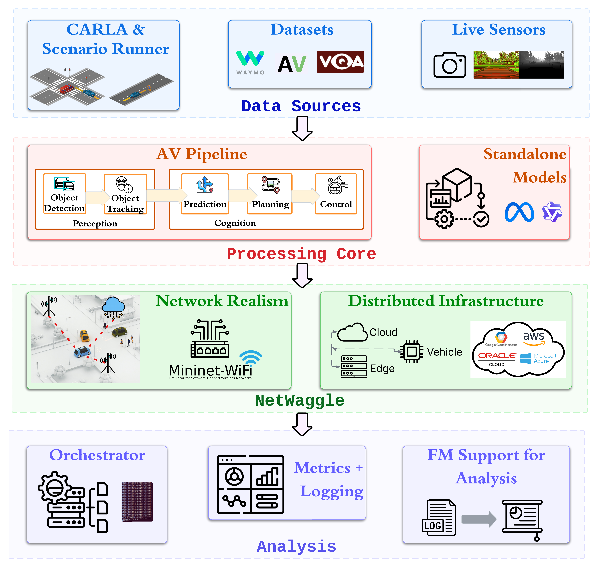

CADET
=====

**Cooperative Autonomy through Distributed Experimentation Toolkit.**

CADET runs controlled experiments on distributed cyber-physical and
autonomy systems. Connect your application to a simulator, recorded data,
datasets or live sensors; run its components on one machine or across real
devices (hardware in the loop); emulate the network between them
(message-level delay, kernel netem, or Mininet/Mininet-WiFi via
NetWaggle); sweep parameters across a full matrix; and get per-frame
latency, age of information, energy and link statistics for every run,
with a dashboard and LLM-assisted log analysis.

Application domains include autonomous vehicles (V2V cooperative
braking, V2I infrastructure-assisted perception), multi-sensor networks
(multi-sensor fan-in, detector placement sweeps), model benchmarking
(YOLO variants across link conditions), and any perception pipeline that
separates data capture from inference by a network hop.

   (a) CADET implements a modular four-layer architecture allowing components
   to be evaluated in isolation or integrated for end-to-end cooperative
   autonomy experiments. (Figure from the CADET paper.)

.. rubric:: Get started

::

    git clone https://github.com/nesl/cadet
    cd cadet
    pip install -U pip
    pip install -e ".[examples]"
    cadet run examples/distributed_sensing/quick.yaml \
        --app-module examples.distributed_sensing.app

.. rubric:: Quick links

- :doc:`quickstart`: install, validate, and run your first experiment
- :doc:`research-goals/index`: map your research question to CADET layers
- :doc:`ways-to-use`: reproduce, configure, or extend
- :doc:`examples/index`: AV, distributed sensing and dataset benchmarks
- :doc:`reference/tested-configurations`: every source x processing x
  network x infrastructure combination verified
- :doc:`explanation/architecture`: how the four layers fit together
- :doc:`api/index`: Python API reference
- :doc:`community/citing`: how to cite this work
- `Source on GitHub <https://github.com/nesl/cadet>`_

----

.. rubric:: What each layer gives you

**Data Source** — feed any experiment

- CARLA 0.9.10 simulator (fixed-timestep, async control loop) for AV scenarios
- Replay from an images directory or video file — reproduce any run offline
- Synthetic in-memory source — no simulator, no GPU, runs in seconds
- Live sensor: camera device index or network stream URL (RTSP, HTTP)
- Dataset: VQAv2/COCO images and questions, scored against ground truth
- :doc:`tutorials/01-first-experiment` · :doc:`howto/replay-source` · :doc:`howto/synthetic-source` · :doc:`howto/live-source`

**Processing Core** — swap perception without touching orchestration

- Model registry maps logical names to per-device artifact paths
  (``gpu``, ``edge``, ``hailo`` keys); CADET selects the right artifact
  for each node's ``device`` field
- Braking pipeline: detect → ROI-gate → brake decision, config-wired;
  general detection / tracking / prediction stages via app plugins
- Dataset mode: benchmark a vision-language model on public datasets
  (VQAv2, COCO) across device/edge/cloud placements
- FM-assisted analysis: summarise and query any run's logs with a language
  model (``cadet summarize`` / ``cadet ask``)
- :doc:`howto/model-registry` · :doc:`tutorials/06-write-an-app` · :doc:`examples/dataset-vlm`

**NetWaggle** — three levels of network realism

- ``delay``: message-level, exact distribution (constant, normal, lognormal, trace)
- ``netem``: packet-level via ``tc`` inside node containers — TCP retransmit visible
- ``netwaggle``: Mininet-WiFi wired topology via ``cadet emulate``
- All three backends support loss, bandwidth caps, and Cartesian sweeps over
  link parameters
- :doc:`tutorials/03-backends` · :doc:`howto/link-distributions` · :doc:`howto/wifi-cell` · :doc:`explanation/network-backends`

**Analysis** — full lifecycle, metrics, and results dashboard

- Orchestrator lifecycle: cleanup → preflight → netem → server → sim → client;
  ``docker`` and ``ssh_docker`` launchers for containerised and multi-machine
  runs; ``ssh_venv`` for remote Python environment deployments
- Cartesian sweep with content-derived run IDs; interrupt and resume any sweep
- Per-run metrics: frame latency, age of information, link report, queue depth,
  GPU/CPU/energy/bandwidth collectors, per-run clock-offset measurement
- Results dashboard (``cadet dashboard``): live sweep matrix, crossover plot,
  per-run and per-device views — all inline SVG, nothing fetched from the network
- WebSocket transport (``transport.protocol: websocket``) for links that cross
  HTTP-only infrastructure
- :doc:`tutorials/04-multi-device` · :doc:`tutorials/05-sweeps` · :doc:`howto/dashboard` · :doc:`reference/metrics`

----

.. rubric:: Paper

| **CADET: A Modular Platform for Evaluating Distributed Cooperative**
| **Autonomy in Connected Autonomous Vehicles**
| Pragya Sharma, Brian Wang, Mani Srivastava · UCLA NESL

See :doc:`community/citing` for the full citation and BibTeX entry.

----

.. toctree::
   :maxdepth: 2
   :hidden:
   :caption: Getting started

   quickstart
   getting-started/installation
   getting-started/versions

.. toctree::
   :maxdepth: 1
   :hidden:
   :caption: Research goals

   research-goals/index
   research-goals/cooperative-driving
   research-goals/computation-placement
   research-goals/communication
   research-goals/model-benchmarking
   research-goals/distributed-sensing

.. toctree::
   :maxdepth: 1
   :hidden:
   :caption: Using CADET

   ways-to-use

.. toctree::
   :maxdepth: 2
   :hidden:
   :caption: Tutorials

   tutorials/01-first-experiment
   tutorials/02-carla-braking
   tutorials/03-backends
   tutorials/04-multi-device
   tutorials/05-sweeps
   tutorials/06-write-an-app
   tutorials/07-v2v-v2i

.. toctree::
   :maxdepth: 2
   :hidden:
   :caption: How-to guides

   howto/replay-source
   howto/synthetic-source
   howto/live-source
   howto/model-registry
   howto/link-distributions
   howto/wifi-cell
   howto/transport-tuning
   howto/sweeps
   howto/dashboard
   howto/outputs
   howto/cadet-down

.. toctree::
   :maxdepth: 2
   :hidden:
   :caption: Reference

   config-reference
   reference/cli
   reference/metrics
   reference/output-format
   reference/tested-configurations
   api/index

.. toctree::
   :maxdepth: 2
   :hidden:
   :caption: Explanation

   explanation/architecture
   explanation/data-source-layer
   explanation/processing-core-layer
   explanation/netwaggle-layer
   explanation/analysis-layer
   explanation/network-backends
   explanation/reproducibility
   explanation/design-goals
   explanation/dataset-mode
   explanation/requirements-and-scope

.. toctree::
   :maxdepth: 2
   :hidden:
   :caption: Apps

   apps

.. toctree::
   :maxdepth: 2
   :hidden:
   :caption: Examples

   examples/index
   examples/dataset-vlm

.. toctree::
   :maxdepth: 1
   :hidden:
   :caption: Help

   faq

.. toctree::
   :maxdepth: 2
   :hidden:
   :caption: Community

   community/citing
   community/contributing
