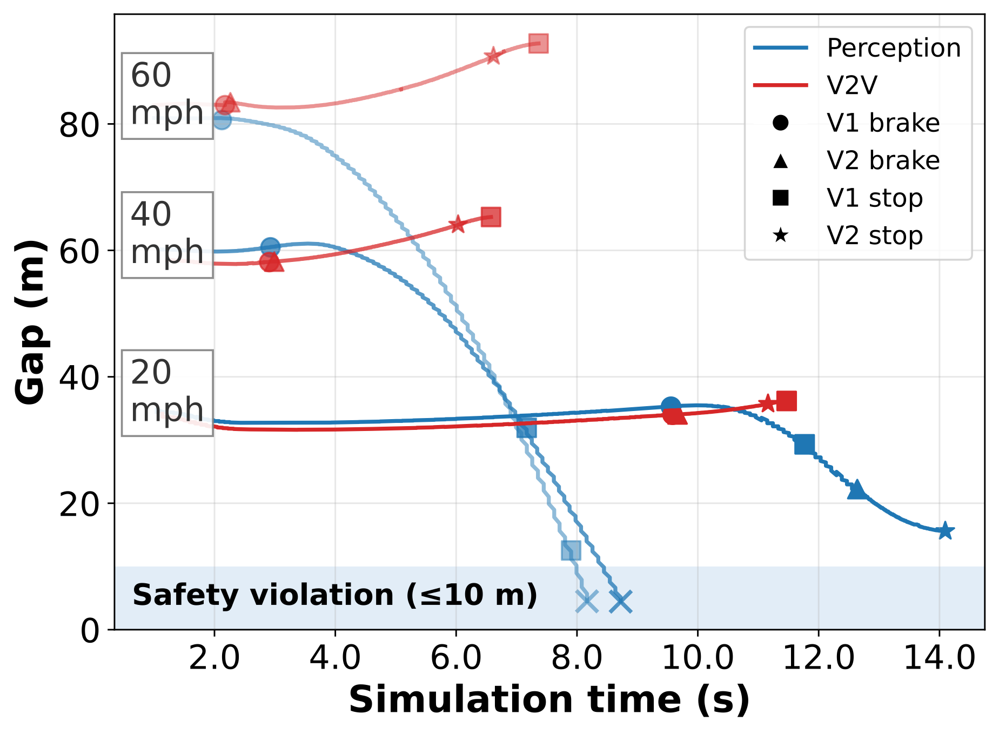
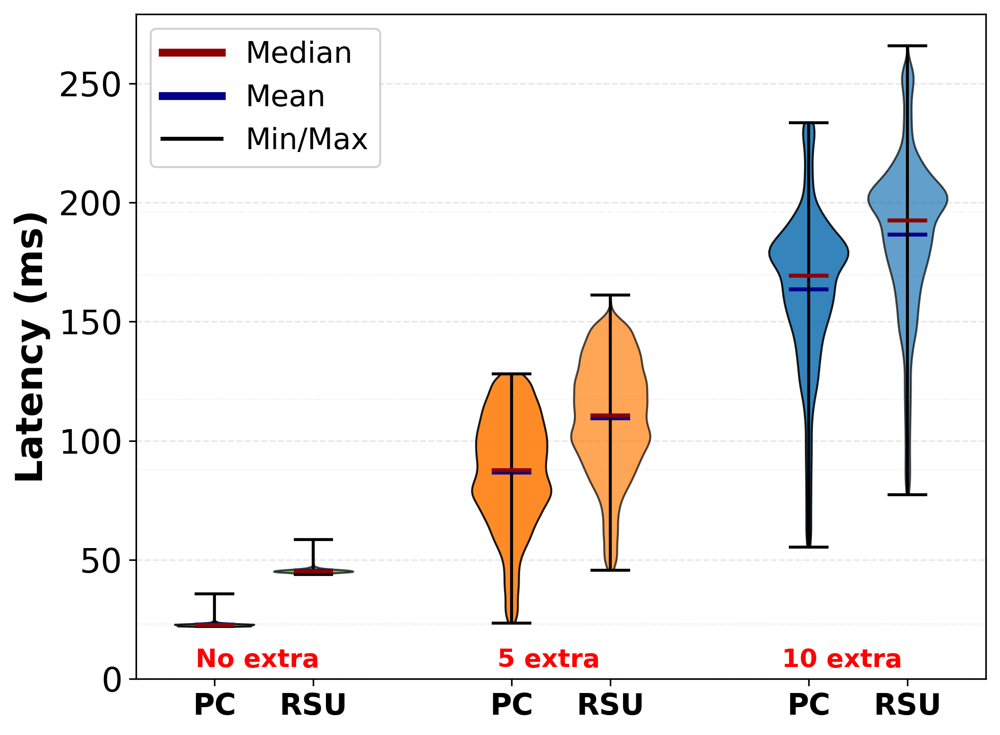

Tutorial 7: V2V and V2I Experiments
=====================================

Prerequisites: :doc:`02-carla-braking` must be working. Both scenarios run
on a single host, with the ``delay`` mode emulating the inter-vehicle link
latency, so neither needs a multi-host deployment.

The companion configs are ``examples/v2v/v2v_braking.yaml`` and
``examples/v2i/v2i_braking.yaml``, each driven by the app plugin beside it.
Check either one before running it::

    cadet validate examples/v2v/v2v_braking.yaml \
        --set source.carla.host=127.0.0.1 \
        --app-module examples.v2v.app
    cadet validate examples/v2i/v2i_braking.yaml \
        --set source.carla.host=127.0.0.1 \
        --app-module examples.v2i.app

----

V2V: cooperative braking
------------------------

The V2V scenario has a scripted leader vehicle and a follower ego on the same
CARLA map. The leader applies emergency braking when a hazard enters its path.
Before its own braking actuator fires, it sends a braking-intent packet to the
follower over a CADET link. The follower receives the packet and brakes without
waiting for its own camera-based perception to detect the same hazard.

The experiment measures the follower's reaction advantage: does it brake in time
to avoid a collision that camera-only perception would have missed? The default
config uses ``braking_mode: v2v`` (leader sends intent packets) for the
cooperative path, and can be switched to ``braking_mode: perception`` to test a
baseline where the follower brakes only on the server's own TTC decision.

The default config (``examples/v2v/v2v_braking.yaml``, field
``links[0].network.distribution``) uses a constant 20 ms delay — the DSRC 802.11p
baseline. The paper characterises the tail as up to 50 ms; to use that as the
constant value, set ``value_ms: 50.0`` in the sweep or ``--set`` flag.

The paper's 5G link model is lognormal with p50 = 30 ms and p99 = 100 ms (both
from the paper directly). The CADET lognormal backend takes these two percentiles
directly as ``p50_ms`` and ``p99_ms``; sigma is derived internally as
ln(p99/p50) / 2.3263. The full validated snippet:

.. literalinclude:: ../../snippets/v2v-lognormal-link.yaml
   :language: yaml
   :caption: Lognormal 5G link — ``docs/snippets/v2v-lognormal-link.yaml``

The ``delay`` mode samples the distribution per message. The ``netem`` and
``netwaggle`` backends cannot render this spread: a p99/p50 ratio above 2× causes
them to refuse the parameter.

**Sweep example: delay vs. ego speed**

.. code-block:: yaml

   sweep:
     axes:
       links[0].network.distribution.value_ms: [10, 20, 40, 80]
       source.scenario.ego_speed:              ["20mph", "40mph", "60mph"]

Starting conditions: ``ego_speed: 20mph``, ``headway_m: 30.0``. The follower's
TTC gate fires at ``ttc.thresh_s: 2.0`` (two consecutive frames below threshold,
``k_frames: 2``).

**Running the V2V scenario:**

.. code-block:: bash

   cadet run examples/v2v/v2v_braking.yaml \
       --set source.carla.host=$(hostname -I | awk '{print $1}') \
       --app-module examples.v2v.app

**Results: gap vs. simulation time**

   (V2V) Leader–follower gap over time at different speeds under
   perception-only and V2V-based braking. (Figure from the CADET paper.)

.. raw:: html

   <video controls muted loop autoplay style="max-width:100%;margin:1em 0">
     <source src="../_static/paper-v2v-demo.mp4" type="video/mp4">
   </video>

Under p90 and p99 network tails, YOLO11l and YOLO11x collide despite higher accuracy; V2V intent stays collision-free at all delay percentiles.

.. raw:: html

   <table class="docutils align-default" style="width:100%">
     <thead>
       <tr>
         <th>Policy</th>
         <th>Object Detector</th>
         <th>Energy (J)</th>
         <th>p50</th>
         <th>p80</th>
         <th>p90</th>
         <th>p99</th>
       </tr>
     </thead>
     <tbody>
       <tr>
         <td>V2V</td><td>—</td><td>—</td>
         <td class="outcome-safe">Safe</td>
         <td class="outcome-safe">Safe</td>
         <td class="outcome-safe">Safe</td>
         <td class="outcome-safe">Safe</td>
       </tr>
       <tr>
         <td rowspan="5">Perception (Cloud)</td>
         <td>YOLO11n</td><td>0.73</td>
         <td class="outcome-safe">Safe</td>
         <td class="outcome-safe">Safe</td>
         <td class="outcome-safe">Safe</td>
         <td class="outcome-safe">Safe</td>
       </tr>
       <tr>
         <td>YOLO11s</td><td>0.76</td>
         <td class="outcome-safe">Safe</td>
         <td class="outcome-safe">Safe</td>
         <td class="outcome-safe">Safe</td>
         <td class="outcome-safe">Safe</td>
       </tr>
       <tr>
         <td>YOLO11m</td><td>0.92</td>
         <td class="outcome-safe">Safe</td>
         <td class="outcome-safe">Safe</td>
         <td class="outcome-safe">Safe</td>
         <td class="outcome-safe">Safe</td>
       </tr>
       <tr>
         <td>YOLO11l</td><td>1.27</td>
         <td class="outcome-safe">Safe</td>
         <td class="outcome-safe">Safe</td>
         <td class="outcome-collision">Collision</td>
         <td class="outcome-collision">Collision</td>
       </tr>
       <tr>
         <td>YOLO11x</td><td>1.66</td>
         <td class="outcome-safe">Safe</td>
         <td class="outcome-safe">Safe</td>
         <td class="outcome-collision">Collision</td>
         <td class="outcome-collision">Collision</td>
       </tr>
     </tbody>
   </table>

*Table II from the CADET paper. Green = Safe (no collision), red = Collision.*

----

V2I: perception extension via roadside camera
---------------------------------------------

The V2I scenario places a roadside unit (RSU) camera above an intersection in
CARLA map Town05. A truck partially occludes a pedestrian in the crossing; the
ego vehicle's own camera cannot detect the pedestrian. The RSU's camera does
detect the pedestrian and streams frames to the same server node alongside the
ego frames. The server merges both views before making a braking decision.

There are four operating modes, controlled by ``app.params.mode``:

``baseline_local`` (default)
    Ego frames only; RSU disabled. The ego camera must detect the pedestrian
    without infrastructure help. This is the hardest mode.

``baseline_cloud``
    Ego frames only, with a simulated 50 ms cloud hop (``hop_mode: blocking``
    in the server, the same as the original implementation). To model the hop
    as a link delay instead, set ``hop_mode: link`` and add a link entry.

``v2i_local``
    Both ego and RSU frames fused at the server, no extra cloud hop. The RSU
    camera extends detection of the occluded pedestrian.

``v2i_external``
    Both cameras, with an additional external processing hop. Models the case
    where the RSU's detector is not co-located with the server.

The example config declares two channels (one per camera) and no link
(``links: []``); the RSU and ego client run on the same host:

.. code-block:: yaml

   channels:
     - name: ego_frames
       from: client
       to: server
       stream_fps: 15
       device_id: ego
     - name: infra_frames
       from: client
       to: server
       stream_fps: 15
       device_id: infra

The RSU camera is mounted at 15.8 m height, pitched −39°, with a 70° FoV.
These defaults are in ``V2IParams.infra_camera`` (``examples/v2x_params.py``)
and match the CARLA pole-camera pose used in the paper.

**Sweep example: visibility vs. mode**

Weather presets vary the visibility level available to the RSU camera.
``clear`` is full-sun baseline, ``light`` is dusk with drizzle, and ``high``
is night with heavy rain:

.. code-block:: yaml

   sweep:
     axes:
       source.weather:    [clear, light, high]
       app.params.mode:   [baseline_local, v2i_local]

**Running the V2I scenario:**

.. code-block:: bash

   cadet run examples/v2i/v2i_braking.yaml \
       --set source.carla.host=$(hostname -I | awk '{print $1}') \
       --set app.params.mode=v2i_local \
       --app-module examples.v2i.app

**Results: RSU latency under load**

   (a) End-to-end latency distribution under increasing concurrent load
   (no extra, +5, +10 clients) for perception on cloud (PC) and RSU.
   (Figure from the CADET paper.)

.. raw:: html

   <video controls muted loop autoplay style="max-width:100%;margin:1em 0">
     <source src="../_static/paper-v2i-demo.mp4" type="video/mp4">
   </video>

----

Shared notes
------------

The output CSV for each run follows the same schema as the braking experiment
(``{run_id}_latency_location_log.csv``), with the same ``brake_reaction_latency_s``
column. Analysis scripts from Tutorial 2 work without modification.
